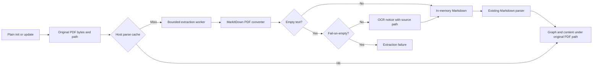

# Repowise MarkItDown plugin

An in-memory PDF document extractor for Repowise, using Microsoft's
[MarkItDown](https://github.com/microsoft/markitdown). Install the plugin alongside
a compatible host, then use ordinary `repowise init` and `repowise update`.
PDF text goes directly into Repowise's existing Markdown parser, with the original
PDF path as the document identity. No Markdown sidecars, output folders or plugin
manifests are created.

## Requirements

Requires Python 3.11+ and Repowise with its `document-extractors` plugin seam.
Install the plugin in the same Python environment as Repowise. Older Repowise
versions without the seam are not supported. Check `repowise plugins` after
installation: `markitdown` must be loaded and claim `.pdf`. A failed plugin
registration can leave PDFs unindexed even if other Repowise commands continue.

## Install

Requires Git and access to this repository. The plugin entry point registers the
`markitdown` document extractor for `.pdf`; no `REPOWISE_PLUGINS` configuration is
needed. Matching is case-insensitive, so `.PDF` is supported too.

```sh
gh auth login --hostname github.com
gh auth setup-git

uv tool install --force --python 3.13 \
  --with "git+https://github.com/digimangos/repowise-markitdown-plugin.git@main" \
  repowise

repowise plugins
```

This replaces an existing uv-managed Repowise installation. Confirm `markitdown`
is loaded and claims `.pdf` in the document-extractors seam. Pin a reviewed plugin
commit instead of `main` for reproducible deployments.
For an existing Repowise virtual environment:

```sh
python -m pip install \
  "git+https://github.com/digimangos/repowise-markitdown-plugin.git@main"
repowise plugins
```

The plugin retains `markitdown[all]` as a dependency, but enables only the PDF
converter, with other built-in converters and third-party plugins disabled.
No API key, cloud service or external OCR service is used. MarkItDown's extras
require an Azure SDK prerelease, which is declared explicitly for uv resolution.

## Use

From your Git repository:

```sh
repowise init --yes --no-prose

# After committing PDF additions, changes, renames or removals:
repowise update --index-only

# To include eligible uncommitted changes too:
repowise update --index-only --working-tree
```

Create an initial Git commit before relying on incremental updates. PDF updates
follow the host's normal committed/working-tree rules; the plugin no longer opts
every update into `--working-tree`. Standard post-commit updates use the same
extractor. Plain `init`/`update` require no separate conversion command.
`--no-prose` and `--index-only` avoid LLM documentation generation, not PDF extraction.
The host controls dry-run behaviour, file discovery and exclusions.

When a valid PDF yields no text, the plugin returns a Markdown notice containing
the source file path and a suggestion to try OCR. This notice is indexed content,
not extracted PDF content. To fail instead:

```sh
REPOWISE_MARKITDOWN_FAIL_ON_EMPTY=true repowise update --index-only
```

The variable defaults to `false`; `true`/`1` enable strict mode and `false`/`0`
enable the notice (case-insensitive). Invalid values are rejected. Malformed PDFs
and converter errors always fail. The resolved policy is included in the
extractor's version so strict mode cannot reuse a cached notice. Rebuild with
`repowise init --force --yes --no-prose` after changing policy if an ordinary
update has no source changes to process.

For `documents/guide.pdf`, graph entries use **`documents/guide.pdf`**, not a
generated Markdown path. PDFs with the same basename in different directories
remain distinct. The extractor reads the supplied bytes, not the live path,
so historical snapshots are not accidentally replaced with current file content.

## Processing pipeline

1. Repowise discovers eligible files and routes unsupported `.pdf` extensions
   through the registered document extractor. Existing code parsers take precedence.
2. The host checks its parse cache using original source bytes plus extractor
   identity/version. The plugin version includes plugin and MarkItDown versions
   and the resolved fail-on-empty policy.
3. On a cache miss, a host-managed spawned worker converts the supplied PDF bytes
   to Markdown in memory. Empty text becomes an OCR notice unless strict mode
   is enabled. Malformed PDFs and converter errors fail explicitly.
4. Repowise parses and indexes that text under the original PDF path, retaining
   extracted content in its internal cache rather than repository-side copies.
   The host also uses the seam when serving extracted document text to consumers.



## Limitations

| Limitation | What it means for you |
| --- | --- |
| Requires Repowise's document-extractor seam. | Upgrade older hosts before installing this plugin; the plugin cannot add the seam to Repowise. |
| This is text extraction, not native PDF knowledge extraction. | There is no PDF-specific entity model, semantic relationship extraction or original page-level citation mapping. Line numbers refer to extracted text, not PDF page coordinates. |
| Scanned/image-only PDFs need separate OCR. | Empty extraction returns an indexed OCR notice with the source path by default. Set `REPOWISE_MARKITDOWN_FAIL_ON_EMPTY=true` to fail instead. |
| Host discovery, source/output size limits, timeout and worker policies apply. | Ignored or oversized PDFs can be excluded even when their extracted text is small. Check your Repowise version's limits and indexing output. The plugin does not override host policy. |
| The host owns cache lifecycle and incremental detection. | There is no plugin-side cache manifest or converter-only refresh command. Rebuild the index when changing extractor versions if an ordinary update has no source changes to process. |
| Other extractors can claim `.pdf`. | The host's later-registered claim wins; check `repowise plugins` if the expected converter is not used. |

## Migrating from the legacy wrapper

This repository's first release uses native extraction rather than the legacy
`ingest-pdfs` wrapper or experimental repository-preprocessor registration.
Use plain Repowise commands with the
document-extractor seam instead.

Before rebuilding, back up and move old `.repowise-pdfs/` or `docs/repowise-pdfs/`
output trees, including their manifests, **outside the repository**. Preserve local
edits; do not delete the original PDFs. Old Markdown remains ordinary indexable
content if left in place, so retaining it would duplicate document entries.
The plugin does not automatically move or delete files from legacy installations.
Remove committed generated files through your normal Git workflow, then run:

```sh
repowise init --force --yes --no-prose
```

Verify graph results reference the original PDF paths before discarding backups.
Replace any custom hook or automation that invokes `ingest-pdfs` with plain
`repowise update`. No generated Markdown needs to be committed or kept visible.

## Development and builds

`uv.lock` and `tool.uv.sources` pin a compatible Repowise revision for reproducible
development and CI, including real spawned-worker discovery. This development
pin is not embedded in wheel dependency metadata.

```sh
uv sync --locked --group dev
uv run pytest
uv run ruff check .
uv run ruff format --check .
uv build
uv run python scripts/validate_release.py --dist dist
```

For release artifacts, checksums and publishing, see [RELEASING.md](RELEASING.md).
Building locally does not publish a release or install Repowise globally.

## Community

See [CONTRIBUTING.md](CONTRIBUTING.md) for development and pull requests,
[SUPPORT.md](SUPPORT.md) for help, [SECURITY.md](SECURITY.md) for private vulnerability
reporting and [CODE_OF_CONDUCT.md](CODE_OF_CONDUCT.md) for participation expectations.
The plugin is distributed under the [ISC licence](LICENSE).
